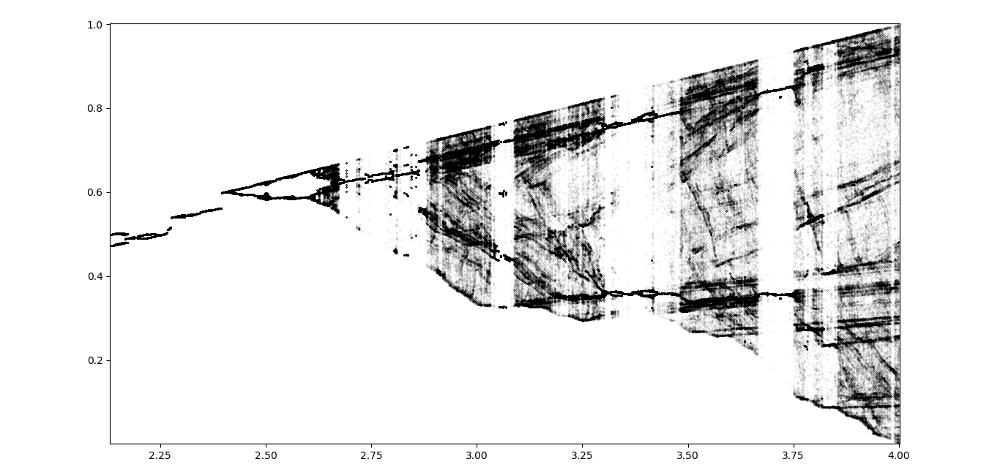
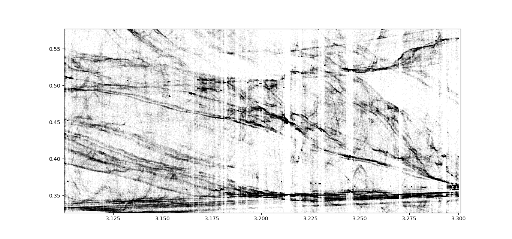
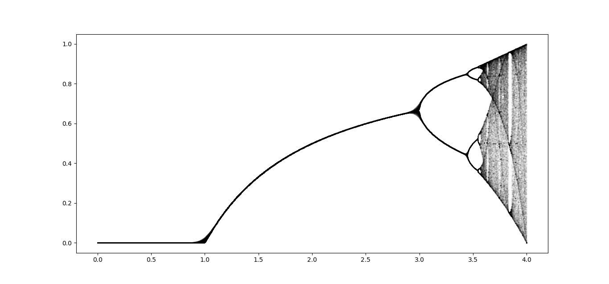
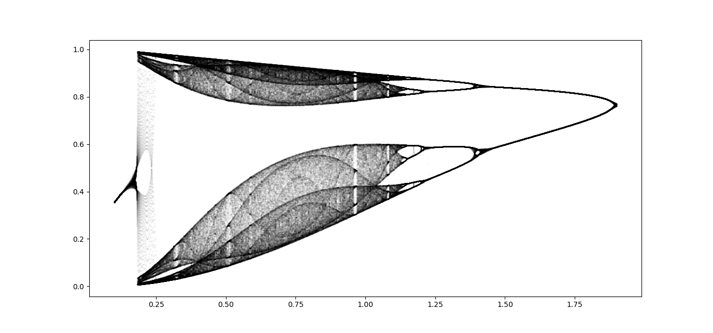

# Description of iterMapChaosGraphing
Python script for visualizing bifurcation diagrams of 1D and 2D maps similar to Logistic Map.
For 2D maps animation is used to visualize dependence on the control parameter. `generate_gif.py` script needs to be run to compile output images into a `.gif` animation.

# Dependencies / checked to run with:
python (3.7.4)  
imageio (2.6.0)  
numpy (1.16.5)  
matplotlib (3.1.1)

# Examples

